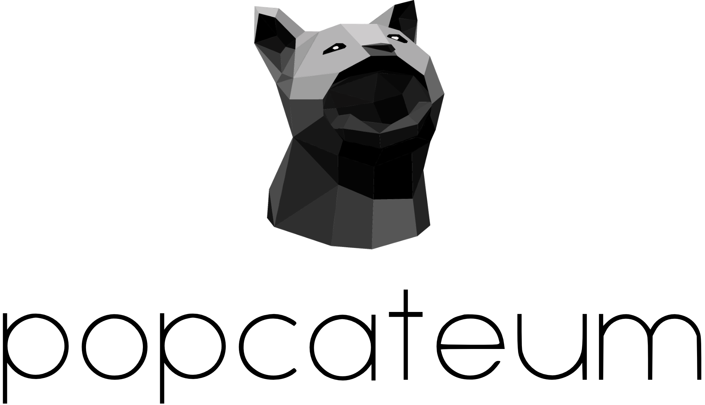

<p align="center">
  
</p>

## Go Popcateum

Official Golang implementation of the Popcateum protocol.

[](https://pkg.go.dev/github.com/popcateum/go-popcateum)
[](https://goreportcard.com/report/github.com/popcateum/go-popcateum)
[](https://travis-ci.com/popcateum/go-popcateum)

This release is based on Geth v1.11.6. On Popcateum mainnet, London and Popstar
activate at block 8,905,000, installing the validator deposit and batch deposit contracts.
The first proof-of-stake block is 9,000,000. For existing chain data, mining, and beacon
node setup, see the [mainnet transition guide](docs/pos-transition.md).

## Building the source

Building `gpop` requires Go 1.20.14 and a C compiler. The Makefile selects Go 1.20.14
when the installed Go launcher supports toolchain selection. From the repository root, run

```shell
make gpop
./build/bin/gpop version
```

To build the full suite of utilities, run

```shell
make all
```

To build the tools for Windows (x64), Linux (x64 and arm64), and macOS (Apple Silicon and Intel), run

```shell
./build/cross-build.sh
```

Each platform has its own directory under `build/bin/`. Pass `./cmd/gpop` to build
only the node. These builds disable cgo, which excludes direct USB hardware wallet access.

## Executables

The go-popcateum project comes with several wrappers/executables found in the `cmd`
directory.

| Command | Description |
| :-----: | ----------- |
| **`gpop`** | Popcateum's execution client. Runs full or archive nodes, serves JSON-RPC over HTTP, WebSocket and IPC, and connects to a beacon node through the Engine API. |
| `clef` | Stand-alone signing tool that can serve as a backend signer for `gpop`. |
| `devp2p` | Utilities for interacting with peers on the networking layer. |
| `abigen` | Generates type-safe Go bindings from a contract ABI and optional bytecode. |
| `bootnode` | Runs peer discovery for a private network. |
| `evm` | Runs and debugs EVM bytecode. |
| `rlpdump` | Displays encoded RLP data in a human-readable form. |
| `depositctl` | Plans, sends, or verifies deposit contract deployment transactions. Popstar installs the mainnet contracts automatically. |

## Running `gpop`

Run `gpop --help` for the full list of flags. The examples below assume that
`build/bin` is on your `PATH`.

### Full node on the main Popcateum network

To start a mainnet node and open its JavaScript console, run

```shell
$ gpop console
```

The default sync mode is `snap`. From the console, `eth.blockNumber` shows the
current execution block. Use `gpop attach` to connect to a running node. After
the Merge, the node follows the chain through a connected beacon client.

### Local development network

For a temporary chain on your machine, run

```shell
$ gpop --dev console
```

### Configuration

As an alternative to passing the numerous flags to the `gpop` binary, you can also pass a
configuration file via:

```shell
$ gpop --config /path/to/your_config.toml
```

To get an idea how the file should look like you can use the `dumpconfig` subcommand to
export your existing configuration:

```shell
$ gpop dumpconfig
```

#### Docker quick start

Build the image from this checkout and start a node with a persistent data volume.

```shell
docker build -t popcateum/client-go .
docker run -d --name popcateum-node -v popcateum-data:/data \
  -p 127.0.0.1:9506:9506 -p 60606:60606/tcp -p 60606:60606/udp \
  popcateum/client-go --datadir /data --http --http.addr 0.0.0.0
```

This exposes JSON-RPC on the host's loopback interface and publishes the TCP and UDP
ports for peer connections.

### Programmatically interfacing `gpop` nodes

As a developer, sooner rather than later you'll want to start interacting with `gpop` and the
Popcateum network via your own programs and not manually through the console. To aid
this, `gpop` has built-in support for a JSON-RPC based APIs ([standard APIs](https://pop.wiki/json-rpc/API)
and [`gpop` specific APIs](https://gpop.popcateum.org/docs/rpc/server)).
These can be exposed via HTTP, WebSockets and IPC (UNIX sockets on UNIX based
platforms, and named pipes on Windows).

The IPC interface is enabled by default and exposes all the APIs supported by `gpop`,
whereas the HTTP and WS interfaces need to manually be enabled and only expose a
subset of APIs due to security reasons. These can be turned on/off and configured as
you'd expect.

HTTP based JSON-RPC API options:

  * `--http` Enable the HTTP-RPC server
  * `--http.addr` HTTP-RPC server listening interface (default: `localhost`)
  * `--http.port` HTTP-RPC server listening port (default: `9506`)
  * `--http.api` API's offered over the HTTP-RPC interface (default: `eth,net,web3`)
  * `--http.corsdomain` Comma separated list of domains from which to accept cross origin requests (browser enforced)
  * `--ws` Enable the WS-RPC server
  * `--ws.addr` WS-RPC server listening interface (default: `localhost`)
  * `--ws.port` WS-RPC server listening port (default: `9507`)
  * `--ws.api` API's offered over the WS-RPC interface (default: `eth,net,web3`)
  * `--ws.origins` Origins from which to accept websockets requests
  * `--ipcdisable` Disable the IPC-RPC server
  * `--ipcpath` Filename for IPC socket/pipe within the datadir (explicit paths escape it)

You'll need to use your own programming environments' capabilities (libraries, tools, etc) to
connect via HTTP, WS or IPC to a `gpop` node configured with the above flags and you'll
need to speak [JSON-RPC](https://www.jsonrpc.org/specification) on all transports. You
can reuse the same connection for multiple requests!

**Note: Please understand the security implications of opening up an HTTP/WS based
transport before doing so! Hackers on the internet are actively trying to subvert
Popcateum nodes with exposed APIs! Further, all browser tabs can access locally
running web servers, so malicious web pages could try to subvert locally available
APIs!**

### Operating a private network

Maintaining your own private network is more involved as a lot of configurations taken for
granted in the official networks need to be manually set up.

#### Defining the private genesis state

First, you'll need to create the genesis state of your networks, which all nodes need to be
aware of and agree upon. This consists of a small JSON file (e.g. call it `genesis.json`):

```json
{
  "config": {
    "chainId": 42424,
    "ethash": {},
    "homesteadBlock": 0,
    "eip150Block": 0,
    "eip155Block": 0,
    "eip158Block": 0,
    "byzantiumBlock": 0,
    "constantinopleBlock": 0,
    "petersburgBlock": 0,
    "istanbulBlock": 0,
    "berlinBlock": 0
  },
  "alloc": {},
  "coinbase": "0x0000000000000000000000000000000000000000",
  "difficulty": "0x20000",
  "extraData": "",
  "gasLimit": "0x2fefd8",
  "nonce": "0x0000000000000042",
  "mixhash": "0x0000000000000000000000000000000000000000000000000000000000000000",
  "parentHash": "0x0000000000000000000000000000000000000000000000000000000000000000",
  "timestamp": "0x00"
}
```

The above fields should be fine for most purposes, although we'd recommend changing
the `nonce` to some random value so you prevent unknown remote nodes from being able
to connect to you. If you'd like to pre-fund some accounts for easier testing, create
the accounts and populate the `alloc` field with their addresses.

```json
"alloc": {
  "0x0000000000000000000000000000000000000001": {
    "balance": "111111111"
  },
  "0x0000000000000000000000000000000000000002": {
    "balance": "222222222"
  }
}
```

With the genesis state defined in the above JSON file, you'll need to initialize **every**
`gpop` node with it prior to starting it up to ensure all blockchain parameters are correctly
set:

```shell
$ gpop --datadir=path/to/custom/data/folder init path/to/genesis.json
```

#### Creating the rendezvous point

With all nodes that you want to run initialized to the desired genesis state, you'll need to
start a bootstrap node that others can use to find each other in your network and/or over
the internet. The clean way is to configure and run a dedicated bootnode:

```shell
$ bootnode --genkey=boot.key
$ bootnode --nodekey=boot.key
```

With the bootnode online, it will display an [`enode` URL](https://pop.wiki/en/fundamentals/enode-url-format)
that other nodes can use to connect to it and exchange peer information. Make sure to
replace the displayed IP address information (most probably `[::]`) with your externally
accessible IP to get the actual `enode` URL.

*Note: You could also use a full-fledged `gpop` node as a bootnode, but it's the less
recommended way.*

#### Starting up your member nodes

With the bootnode operational and externally reachable (you can try
`telnet <ip> <port>` to ensure it's indeed reachable), start every subsequent `gpop`
node pointed to the bootnode for peer discovery via the `--bootnodes` flag. It will
probably also be desirable to keep the data directory of your private network separated, so
do also specify a custom `--datadir` flag.

```shell
$ gpop --datadir=path/to/custom/data/folder --networkid=42424 --bootnodes=<bootnode-enode-url-from-above>
```

*Note: Since your network will be completely cut off from the main and test networks, you'll
also need to configure a miner to process transactions and create new blocks for you.*

#### Running a private miner

For a private proof-of-work chain, pass the same data directory and network ID used
above and set the reward address to your own wallet. One CPU thread is sufficient
for a small test network.

```shell
$ gpop --datadir=path/to/custom/data/folder --networkid=42424 \
  --mine --miner.threads=1 --miner.etherbase="$MINER_ADDRESS"
```

Use `--miner.gaslimit` to set the target gas limit and `--miner.gasprice` to set
the minimum gas price for transactions included by your miner.

## Contribution

Thank you for considering to help out with the source code! We welcome contributions
from anyone on the internet, and are grateful for even the smallest of fixes!

If you'd like to contribute to go-popcateum, please fork, fix, commit and send a pull request
for the maintainers to review and merge into the main code base. If you wish to submit
more complex changes though, please check up with the core devs first on [our gitter channel](https://gitter.im/popcateum/go-popcateum)
to ensure those changes are in line with the general philosophy of the project and/or get
some early feedback which can make both your efforts much lighter as well as our review
and merge procedures quick and simple.

Please make sure your contributions adhere to our coding guidelines:

 * Code must adhere to the official Go [formatting](https://golang.org/doc/effective_go.html#formatting)
   guidelines (i.e. uses [gofmt](https://golang.org/cmd/gofmt/)).
 * Code must be documented adhering to the official Go [commentary](https://golang.org/doc/effective_go.html#commentary)
   guidelines.
 * Pull requests need to be based on and opened against the `main` branch.
 * Commit messages should be prefixed with the package(s) they modify.
   * E.g. "pop, rpc: make trace configs optional"

Please see the [Developers' Guide](https://gpop.popcateum.org/docs/developers/devguide)
for more details on configuring your environment, managing project dependencies, and
testing procedures.

## License

The go-popcateum library (i.e. all code outside of the `cmd` directory) is licensed under the
[GNU Lesser General Public License v3.0](https://www.gnu.org/licenses/lgpl-3.0.en.html),
also included in our repository in the `COPYING.LESSER` file.

The go-popcateum binaries (i.e. all code inside of the `cmd` directory) is licensed under the
[GNU General Public License v3.0](https://www.gnu.org/licenses/gpl-3.0.en.html), also
included in our repository in the `COPYING` file.
